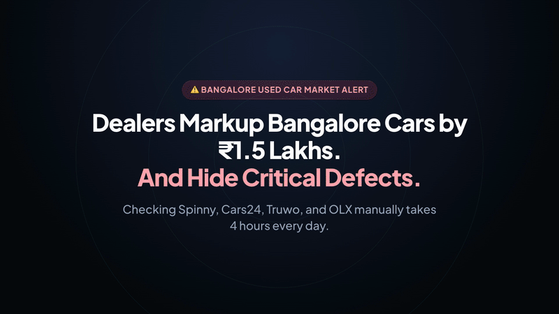

# Bangalore Car Radar — Architecture & System Documentation

Autonomous multi-platform used vehicle radar tracking, scoring, and alert pipeline for the Bangalore pre-owned car market across Spinny, Cars24, Truwo, and OLX.

[](https://kiranpuli.github.io/bangalore-car-radar/)
[](https://github.com/kiranpuli/bangalore-car-radar)
[](https://ntfy.sh/kiran-car-radar)
[](LICENSE)

---

## 🎬 Product Launch Video & Feature Tour

Watch the 18-second product overview showcasing the multi-platform radar sweep, factual price breakdown, fast filters, and instant mobile push alerts:

[](product-launch.mp4)

> Rendered using Hyperframes with synchronized music and interface audio cues. [Download high-definition 1080p MP4 (3.3 MB)](product-launch.mp4).

---

## 1. Overview & Market Intelligence

Bangalore Car Radar aggregates and evaluates pre-owned vehicle inventory across all major automotive platforms in Bangalore. It eliminates speculative dealership markups by computing fair-value ratings, providing factual 2-year resale and maintenance estimates, and monitoring live listings hourly.

| Metric | Live Count / Frequency | Description |
| :--- | :--- | :--- |
| **Tracked Bangalore Cars** | **1,700+** | Live verified inventory across all Bengaluru hubs |
| **Integrated Marketplaces** | **4** | Spinny, Cars24, Truwo, and OLX Bangalore |
| **Sync & Scrape Cadence** | **Hourly (24/7)** | Autonomous background scraping & deal detection |
| **Safe Buying Integration** | **3 Portals** | BTP Police Fines, MoRTH e-Challan, Parivahan VAHAN |

---

## 2. Supported Marketplace Sources

The monitoring pipeline pulls verified inventory with direct vehicle listing URLs and inspection guarantees:

| Platform | Type | Inspection Guarantee | Hubs Covered |
| :--- | :--- | :--- | :--- |
| **Spinny (740+ cars)** | Direct Hub Feeds & APIs | 200-Point Spinny Assured & Max | Whitefield, Yelahanka, Electronic City, Mantri Mall |
| **Cars24 (620+ cars)** | Search API Endpoints | 140-Point Cars24 Assured Warranty | All Bangalore Mega Hubs & Centers |
| **Truwo (210+ cars)** | Curated Hub Inventory | Verified Direct Hub Inspection | Bengaluru South & East Hubs |
| **OLX (210+ cars)** | Direct Private Sellers | Verified Direct Seller Listings | Bengaluru Metropolitan Area |

---

## 3. Deal Scoring Engine (0 to 100)

Every vehicle receives an objective 0 to 100 score evaluating depreciation, mechanical wear, and market demand:

| Component | Weight | Calculation Basis |
| :--- | :--- | :--- |
| **Price Discount vs New** | **Up to 18 Points** | High discount percentage vs original new showroom price. |
| **Odometer & Engine Wear** | **Up to 24 Points** | Low odometer readings (< 40k km) indicate low mechanical wear. |
| **Vehicle Age & Generation** | **Up to 20 Points** | BS6 Phase 2 era (2020+) and modern safety chassis rewarded. |
| **Warranty & Certification** | **Up to 14 Points** | Certified multi-point inspection warranty or direct seller pricing. |
| **Bangalore Market Demand** | **Up to 9 Points** | Trusted high-liquidity brands (Maruti, Hyundai, Honda, Toyota). |

### Curated Top Deal Threshold
Cars scoring **$\ge$ 80/100**, priced **$\le$ ₹4.00 Lakh**, and with **$\le$ 80,000 km** are automatically promoted to the **🔥 Top Deals** curated shortlist and dispatched as push notifications.

---

## 4. Factual Price & Cost Breakdown

Clicking **Price Details** on any car opens a transparent buyer breakdown:

1. **Estimated 2-Year Resale Value:** Data-driven forecast of vehicle market value after 24 months of Bangalore driving (~70-80% retention for trusted brands).
2. **Yearly Service & Upkeep Budget:** Realistic annual estimates for routine oil changes, filter replacements, and regular brake/tyre upkeep.
3. **Showroom Price Savings:** Exact rupee difference and percentage saved compared to buying the same model brand new today.
4. **Monthly Value Loss Rate:** Normal market depreciation rate.
5. **Safe Buying Checklist & Government Portals:**
   - 🚨 **Bangalore Traffic Police (BTP):** Real-time fine checks for signal jumping and speeding cameras.
   - 📋 **MoRTH e-Challan:** All-India highway fine verification.
   - 🏛️ **Parivahan VAHAN:** Verification of registered owner serial number, road tax status, and bank hypothecation / loan NOC.

---

## 5. Modern Filter Control Deck & Mobile Architecture

The dashboard provides a responsive, dual-mode filter architecture designed for rapid refinement across both desktop and mobile viewports:

### Mobile Viewport (< 768px): Vaul-Style Bottom Sheet
- **Sticky Search & Filter Bar:** Instant multi-word search, sort selector, and `⚙️ Filters [count]` trigger button.
- **Horizontal Quick-Chip Strip:** 1-Touch facet chips (`🔥 Top Deals`, `⚡ Automatic`, `💰 Under ₹4L`, `All Cars`) with real-time inventory counts.
- **Smooth Bottom Sheet Drawer:** Tapping `Filters` slides up a native-feeling drawer with pull handle, housing budget sliders, age, mileage, transmission, fuel, and brand chips.
- **Light & Dark Theme Toggle:** Theme toggle available on both mobile header and desktop nav.

### Desktop Viewport (≥ 768px): Symmetrical Filter Deck
- **⌘K Command Menu:** Keyboard-accessible command palette with instant quick choices (*Under ₹4 Lakh*, *Automatic Cars*, *Low Mileage*, *Brand Shortcuts*).
- **Budget Slider & Number Fields:** Exact numerical input boxes for Minimum and Maximum price in Lakhs (₹ L), paired with a continuous scrub slider.
- **Transmission Panel:** Dedicated gearbox facet panel with live count badges for `All`, `⚡ Automatic`, and `🕹️ Manual`.
- **Fuel Type Panel:** Discrete counts for `Petrol`, `Diesel`, and `CNG`.
- **Source Platforms:** Multi-select buttons for Spinny, Cars24, Truwo, and OLX with live count badges.
- **Automaker Chips:** One-click brand chips for Maruti, Hyundai, Tata, Honda, Volkswagen, Toyota, Skoda, BMW, Mahindra, Renault, and MG.
- **Model Exclusion (Hide Model):** Permanent model exclusion button on cards and modals, persisting hidden models in browser `localStorage`.

---

## 6. Real-Time Push Notification Pipeline

Delivers push alerts directly to Android and iOS devices via **ntfy.sh** with zero registration:

```bash
# Test sending a push notification right from your terminal:
curl -d "🔥 2020 Maruti Swift dropped to ₹4.10L in Bangalore!" \
     -H "Title: Bangalore Car Radar Alert" \
     -H "Click: https://kiranpuli.github.io/bangalore-car-radar/" \
     https://ntfy.sh/kiran-car-radar
```

---

## 7. Developer CLI Commands

```bash
# 1. Rebuild Web Dashboard (generates index.html and deals.html)
python3 build_ui.py

# 2. Run Headless Scrapers
python3 spinny_checker.py --headless

# 3. Test Search & Quick Choices (Playwright)
python3 scratch/test_cmdk_quick_choices.py

# 4. Re-render 1080p Launch Video (Hyperframes)
cd brag-output/composition && npx hyperframes render --quality high -o ../brag.mp4
```

---

<div align="center">

### Ready to find your car?

[**👉 Open Bangalore Car Radar (100% Free)**](https://kiranpuli.github.io/bangalore-car-radar/)

<sub>Maintained by [Kiran Puli](https://github.com/kiranpuli) • Standalone documentation at [documentation.html](documentation.html) • Push Channel: [ntfy.sh/kiran-car-radar](https://ntfy.sh/kiran-car-radar)</sub>

</div>
