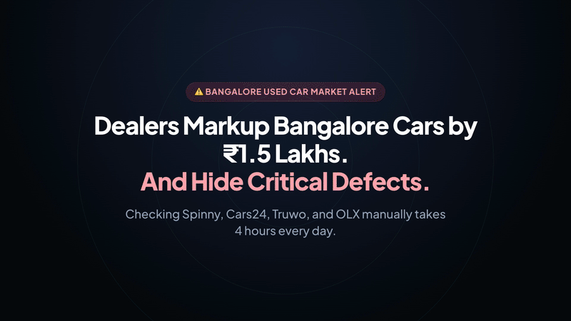
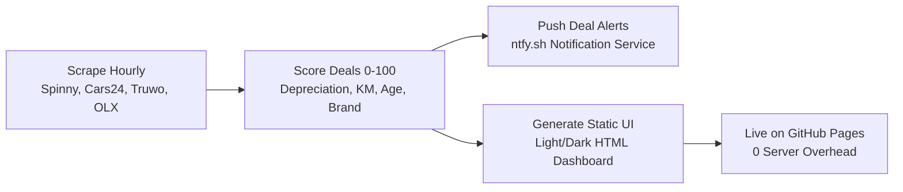

<div align="center">

# 🏎️ Bangalore Car Radar

### **Find your dream car in Bangalore — without the headache ✨**

[](https://kiranpuli.github.io/bangalore-car-radar/)
[](https://kiranpuli.github.io/bangalore-car-radar/)
[](https://ntfy.sh/kiran-car-radar)
[](https://kiranpuli.github.io/bangalore-car-radar/)

*The free, fast, and friendly car finder that checks 1,700+ verified used cars across Spinny, Cars24, Truwo, and OLX every hour — with honest price scores, full cost breakdowns, and instant deal alerts.*

[**🚀 Open Free Dashboard**](https://kiranpuli.github.io/bangalore-car-radar/) &nbsp;•&nbsp; [**📲 Get Phone Push Alerts**](https://ntfy.sh/kiran-car-radar) &nbsp;•&nbsp; [**🎬 1080p Launch Video**](product-launch.mp4) &nbsp;•&nbsp; [**📖 Buyer Guide & FAQs**](documentation.html)

<br/>

[](https://kiranpuli.github.io/bangalore-car-radar/)

<sub>🎬 18-second video overview showing real-time radar sweep, price breakdown, fast filters, and instant push alerts. <a href="product-launch.mp4">Download 1080p MP4 with sound</a>.</sub>

</div>

---

## ⚡ Why Bangalore Car Radar?

Buying a used car in Bangalore usually means opening 4 different apps every day, dealing with aggressive salespeople, and worrying if the car has unpaid traffic fines or a hidden bank loan.

Bangalore Car Radar solves that in one clean screen:

| Traditional Car Shopping | Bangalore Car Radar |
| :--- | :--- |
| ❌ Jumping between Spinny, Cars24, Truwo & OLX tabs every day | ✅ **1,700+ verified Bangalore cars unified into one high-speed dashboard** |
| ❌ Paying dealer markups of ₹1,00,000 to ₹1,50,000 | ✅ **Honest price ratings spotlighting true bargains under ₹4 Lakh** |
| ❌ Hidden unpaid traffic fines or active bank loans discovered late | ✅ **Direct 1-tap links to official Bangalore Police (BTP) & Parivahan checks** |
| ❌ Guessing future maintenance bills and resale value | ✅ **Transparent 2-year estimated resale value and yearly service budgets** |
| ❌ Missing good cars because someone else saw them first | ✅ **Free instant push notifications straight to your phone (Android & iOS)** |

---

## 🎯 6 Features You'll Love

### 1. 🔍 Four Major Marketplaces in One Radar
No more tab juggling. Every hour, our scrapers sync live pre-owned cars across all Bangalore hubs:
- **Spinny (740+ cars):** Whitefield, Yelahanka, Electronic City, and Mantri Mall hubs.
- **Cars24 (620+ cars):** Assured inspection centers across the city.
- **Truwo (210+ cars):** Verified direct inventory across Bengaluru South & East.
- **OLX (210+ cars):** Hand-picked direct private sellers with zero dealer markup.

### 2. 💰 Hand-Picked Deals Under ₹4 Lakh
Looking for an affordable first car? Tap **🔥 Top Deals** or **💰 Under ₹4L** to instantly see vetted cars with high savings vs new showroom price, low odometer readings, and healthy mechanical life.

### 3. ✨ Transparent Price & Cost Breakdown
Click any vehicle's **Price Details** to see what you'll actually spend:
- **Estimated 2-Year Resale Value:** Know what you'll get back if you sell in 24 months.
- **Yearly Service & Upkeep Budget:** Realistic annual estimates for routine oil changes and maintenance.
- **Savings vs Brand New:** Real price difference compared to original showroom ex-showroom cost.
- **Monthly Depreciation Rate:** Transparent market price drop expectations.

### 4. 🛡️ Safe Buying Checklist & Official Government Portals
Never pay a booking deposit without checking the car's legal status:
- 🚨 **Bangalore Traffic Police (BTP):** 1-Click link to enter the plate number and inspect unpaid speeding or signal fines.
- 📋 **MoRTH e-Challan:** Check national highway violations.
- 🏛️ **Parivahan VAHAN:** Confirm ownership count, fitness expiry, and bank loan clearance (NOC).

### 5. ⚡ ⌘K Command Search & Quick Choices
Press `⌘K` (or tap `Find`) anytime for lightning-fast search:
- **Instant Quick Choices:** 1-Click buttons for *Under ₹4 Lakh*, *Automatic Cars*, *Low Mileage (< 40,000 km)*, and *German Cars*.
- **Trusted Brands:** Jump straight to *Maruti Suzuki*, *Hyundai*, *Tata Motors*, or *Honda*.
- **Multi-Word Instant Search:** Search "Swift Automatic" or "Honda City Petrol" in real time.

### 6. 📲 1-Tap Mobile Push Notifications
Top Bangalore deals get booked in under 3 hours. Connect your phone via **ntfy.sh** (free, open source, zero signups) to get pinged the second a matching deal drops:

```bash
# Test a push alert from your terminal:
curl -d "🔥 2020 Maruti Swift dropped to ₹4.10L in Bangalore!" \
     -H "Title: Bangalore Car Radar Alert" \
     -H "Click: https://kiranpuli.github.io/bangalore-car-radar/" \
     https://ntfy.sh/kiran-car-radar
```

---

## 🎨 Clean Light & Dark Themes

Built for real humans, not just developers. Switch seamlessly between dark and light themes using the top-bar toggle. Clean contrast, generous touch targets for mobile phones, and simple English with zero confusing technical jargon.

---

## ⚙️ How It Works Behind the Scenes



1. **Hourly Sweep:** Scrapers run every hour to pull new listings and remove sold inventory.
2. **Deal Scoring:** Calculates fair value based on Bangalore market resale demand, age, and mileage.
3. **Instant Alerts:** Qualifying deals trigger instant mobile notifications.
4. **Zero-Lag UI:** `build_ui.py` compiles everything into a fast, single-file dashboard hosted on GitHub Pages.

---

## 💻 Quick Developer Commands

```bash
# 1. Rebuild Web Dashboard (generates index.html and deals.html)
python3 build_ui.py

# 2. Run Headless Scrapers
python3 spinny_checker.py --headless

# 3. Test Search & Quick Choices (Playwright test suite)
python3 scratch/test_cmdk_quick_choices.py

# 4. Re-render 1080p Launch Video (Hyperframes)
cd brag-output/composition && npx hyperframes render --quality high -o ../brag.mp4
```

---

<div align="center">

### Ready to find your car?

[**👉 Open Bangalore Car Radar (100% Free)**](https://kiranpuli.github.io/bangalore-car-radar/)

<sub>Built by [Kiran Puli](https://github.com/kiranpuli) • Real-Time Deal Alerts: [ntfy.sh/kiran-car-radar](https://ntfy.sh/kiran-car-radar)</sub>

</div>
